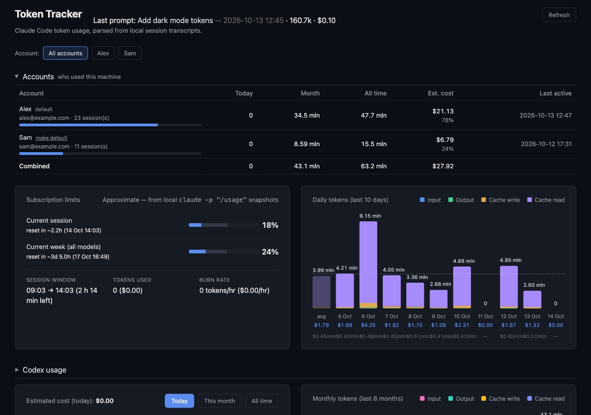

# Token Tracker

See what your [Claude Code](https://claude.com/claude-code) usage adds up to: tokens and estimated cost per
project, session and prompt, your subscription limits, and, if more than one person uses the
same machine, a separate view for each Claude account. It reads the logs Claude Code already
writes on your disk, keeps everything in a local SQLite file, and sends nothing anywhere.



- **Cost and tokens** by day, week and month, by project, by session and by prompt, with
  cache reads and writes shown separately.
- **Subscription limits** (the 5-hour session and the weekly limit) with a projection of when you
  would run out at the current pace.
- **Several accounts on one machine.** A guest who logs in with their own account shows up under
  their own label, next to a combined total. See [Several accounts](#several-accounts-on-one-machine).
- **[Codex CLI](https://github.com/openai/codex)** usage and limits in the same dashboard, see
  [CODEX.md](CODEX.md).
- An optional always-on-top macOS desktop widget, see [widgets/hammerspoon](widgets/hammerspoon/README.md).

## Requirements

- Python 3.11 or newer
- Node.js 22 (20.19 or newer also works), to build the dashboard
- Claude Code, with its transcripts in `~/.claude`

## Quick start

```bash
git clone https://github.com/YuriyTikhonoff/token-tracker.git
cd token-tracker

python3 -m venv .venv && .venv/bin/pip install -e backend
(cd frontend && npm ci && npm run build:package)   # builds the dashboard (needs Node.js)

.venv/bin/token-tracker ingest                     # read your Claude Code logs
.venv/bin/token-tracker serve                      # open http://127.0.0.1:8765
```

Next time, `.venv/bin/token-tracker run` reads the new activity and starts the dashboard in one
step. Press **Refresh** in the dashboard to pick up activity while it is running, or run
`token-tracker ingest` again.
`token-tracker doctor` checks the setup and says what is missing. A step-by-step guide for a
fresh machine is in [docs/SETUP.md](docs/SETUP.md).

## How it works

```
~/.claude/projects/**/*.jsonl      Claude Code's own transcripts
        │  ingest (incremental: remembers how far it read each file)
        ▼
  SQLite database  ◄── snapshot (runs `claude -p "/usage"` to record the limits)
        │
        ▼
  FastAPI backend  ──►  React dashboard (served by the backend)
```

Everything is read from files Claude Code already writes. The only thing that is run is
`claude -p "/usage"`, to record your subscription limits, and it is optional.

## Several accounts on one machine

Claude Code's logs do not say which account wrote them. Two small hooks fill that in:

```bash
token-tracker install-hooks      # add --dry-run to see what would change
```

This adds two entries to `~/.claude/settings.json` (or `$CLAUDE_CONFIG_DIR/settings.json`), keeps
everything else in the file, and leaves a timestamped backup next to it.
`token-tracker uninstall-hooks` removes them.

- `SessionStart` records who is logged in whenever a session starts or resumes.
- `UserPromptSubmit` records it again only when the account has changed, so a `/login` in the
  middle of a conversation is noticed at the next prompt.

Each row of usage then belongs to the account that was active in its session at that moment. In
the dashboard you get an account switcher, and an **Accounts** section with each account's totals
and share. Click a label to rename an account.

- Usage from before the hooks were installed belongs to the **default** account: the one that was
  logged in when you first ran `ingest`. "make default" in the Accounts section changes that.
- Subscription limits are recorded for whoever is logged in when you refresh, so an account's limit
  bar only moves while that account is active.
- If two people share one Claude account, they cannot be told apart.

## Commands

| Command | What it does |
| --- | --- |
| `run [--host H] [--port P]` | `ingest`, then `serve`: the one command for everyday use |
| `serve [--host H] [--port P]` | the dashboard and API (127.0.0.1:8765 by default; the API has no login, so keep it on localhost) |
| `ingest` | read new Claude Code transcripts into the database |
| `snapshot` | record the subscription limits (needs the `claude` CLI) |
| `report [--top N] [--account ID]` | text report in the terminal |
| `codex` | read new Codex CLI sessions |
| `install-hooks` / `uninstall-hooks` | add or remove the account-tracking hooks |
| `doctor` | check the setup and say what is missing |

## Configuration

Each setting is read from an environment variable, then from `~/.token-tracker/config.toml`, then
falls back to a default. Restart the backend after changing them.

| What | Environment | `config.toml` key | Default |
| --- | --- | --- | --- |
| Data directory | `TOKEN_TRACKER_HOME` | n/a | `~/.token-tracker` |
| Database | `TOKEN_TRACKER_DB` | `db` | `<data directory>/token_tracker.db` |
| Claude Code directory | `CLAUDE_CONFIG_DIR` | `claude_dir` | `~/.claude` |
| Codex directory | `CODEX_HOME` | `codex_dir` | `~/.codex` |
| Time zone | `TOKEN_TRACKER_TZ` | `timezone` | `TZ`, then the system zone, else UTC |

The time zone decides where "today", "this week" and "this month" start and which clock the
dashboard shows; use an IANA name such as `Europe/Kyiv`.

If you use a custom `CLAUDE_CONFIG_DIR`, set the same value for the backend: the transcripts, the
logged-in account (`<dir>/.claude.json`) and the account events are all read from there.

### Prices

Costs are estimates. `backend/token_tracker/pricing.json` holds dollars per million tokens by model,
with the date and source in `_meta`. Cache writes are priced at the 5-minute rate. A model with no
entry is counted at a default rate and listed in a notice on the dashboard. Token counts are exact.
To add or correct a model, put it in `<data directory>/pricing.json`; its entries replace the
shipped ones.

## Keeping it fresh

- The **Refresh** button, or `token-tracker ingest`, whenever you want.
- `backend/watch.sh [seconds]` runs the ingest in a loop in a terminal you keep open.
- `backend/launchd/` has a macOS background agent that runs it every 5 minutes, see
  [its README](backend/launchd/README.md).
- `backend/aliases.sh` gives short shell commands (`tt-refresh`, `tt-report`, `tt-dashboard`) from a
  checkout: `echo "source $PWD/backend/aliases.sh" >> ~/.zshrc`.

## Privacy

Everything stays on your machine. The database holds token counts, model names, project folder
names, timestamps and the first 200 characters of each prompt. The API listens on localhost only by
default and has no authentication. The one thing that can cost anything is the **Refresh** button:
it asks Codex for a fresh rate-limit reading, which spends a small amount of real Codex tokens (the
background refresh never does).

## Limitations

- Costs are estimates, see [Prices](#prices).
- Some usage cannot be traced to a specific prompt (for example sub-agent turns without a resolvable
  parent chain). It is grouped per session as "no prompt id" instead of being dropped.
- The subscription limits come from the text of `claude -p "/usage"`, so a change in its wording can
  break that one widget.
- The database is never pruned; it grows with your history.

## Development

```bash
python3 -m venv .venv && .venv/bin/pip install -e "backend[dev]"
.venv/bin/pytest backend           # tests, on synthetic data
.venv/bin/ruff check backend       # lint

cd backend && ../.venv/bin/uvicorn token_tracker.main:app --reload --port 8765   # API with auto-reload
cd frontend && npm run dev                                                       # http://localhost:5177
```

The frontend checks are `npm run typecheck`, `npm run lint` and `npm run build`. CI runs all of
them on every push to `main`.

## Contributing

This is a personal project with a single maintainer. Pull requests are not accepted for now.

## License

[MIT](LICENSE)
